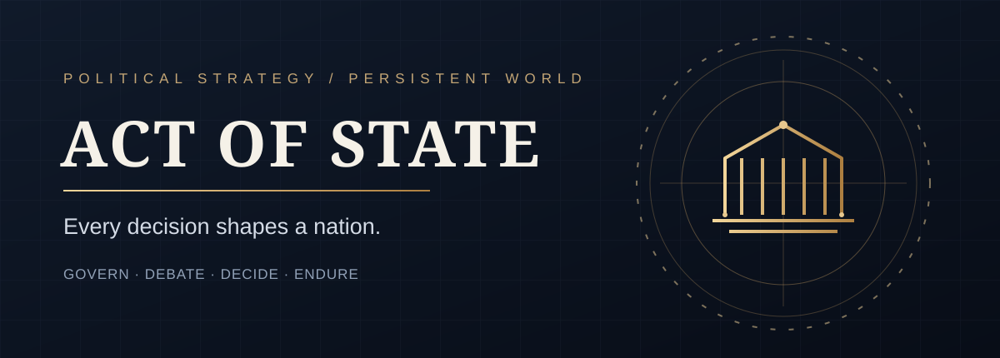
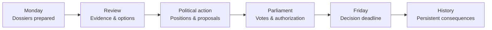
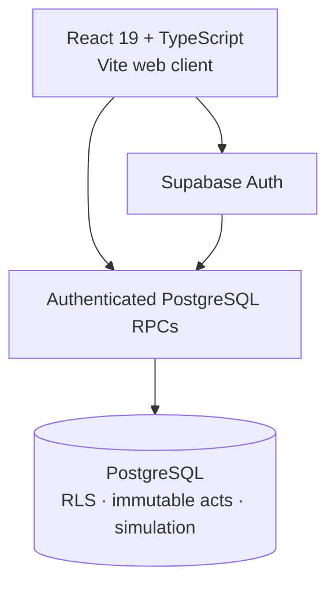

<div align="center">



# ACT OF STATE

### Every decision shapes a nation.

**A persistent political strategy game about power, policy, and consequences.**

Lead a government, challenge it from Parliament, and navigate the political consequences of decisions that endure beyond a single session.

[**Play ACT OF STATE**](https://act-of-state.vercel.app/) · [**Try the guest demo**](https://act-of-state.vercel.app/demo) · [**System status**](https://act-of-state.vercel.app/status) · [**Explore the documentation**](docs/)

<sub>Browser-based · Free to play · English / Spanish product ambition · Active development</sub>

</div>

---

> [!IMPORTANT]
> **Development status:** This is an actively developed game, not a certified finished commercial release. Local and automated multiplayer/authentication tests exist, but hosted end-to-end acceptance, real weekly editorial publication, economic depth, and visual acceptance remain outstanding. The guest demo is a browser-local training experience, **not** a saved online game.

## Explore

[Experience](#the-experience) · [Game systems](#game-systems) · [How a week works](#a-week-in-power) · [Architecture](#architecture) · [Getting started](#getting-started) · [Verification](#verification) · [Development status](#development-status)

## The experience

<table>
<tr>
<td width="50%" valign="top">

### Govern under pressure

Read dossiers, weigh competing interests, review fiscal and social implications, and sign decisions whose effects are recorded in the simulation.

**Implemented:** a persistent fictional ten-dossier founding programme for authenticated solo governments, with 30 authored choices.

[Government programme →](docs/FOUNDATIONAL_GOVERNMENT_PROGRAMME.md)

</td>
<td width="50%" valign="top">

### Share the political arena

Join a shared nation with up to ten distinct political parties. Cabinet proposals, parliamentary votes, and binding acts are resolved by authoritative database operations.

**Implemented:** party seats, recorded positions, ballots, and role-aware legislative workflows. Hosted ten-human acceptance is still pending.

[Multiplayer command centre →](docs/MULTIPLAYER_COMMAND_CENTER.md)

</td>
</tr>
<tr>
<td valign="top">

### Follow the electorate

Explore synthetic households, territorial constituencies, opinion history, campaigns, and election projections. The simulated electorate is fictional gameplay data, not scientific polling.

[Household simulation →](docs/HOUSEHOLD_SIMULATION.md)

</td>
<td valign="top">

### Live with the consequences

Inspect fiscal and social outcomes, household living conditions, historical political acts, and a persistent political activity inbox.

[Daily living conditions →](docs/DAILY_LIVING_CONDITIONS.md)

</td>
</tr>
</table>

### Try before you govern

The [guest training sandbox](https://act-of-state.vercel.app/demo) offers **four fictional dossiers and twelve alternatives**, local deterministic consequences, review-before-sign decisions, and browser-only progress. No account or backend is required.

**Visual evidence:** Authentic product screenshots have not been added here because a trustworthy browser capture was not available in this execution environment. No conceptual mockups are presented as real gameplay.

## Repository pulse

[](https://github.com/akumanomi1988/act-of-state/stargazers) [](https://github.com/akumanomi1988/act-of-state/forks) [](https://github.com/akumanomi1988/act-of-state/commits/main)

These counters are provided by GitHub-backed badge services; if the service is unavailable, the underlying repository links remain usable.

## Game systems

| System | What it enables | Evidence |
| :-- | :-- | :-- |
| **Executive decisions** | Review, sign, and persist authored policy outcomes | [Founding programme](docs/FOUNDATIONAL_GOVERNMENT_PROGRAMME.md) |
| **Parliament** | Party positions, proposals, voting, and authoritative acts | [Legislative operations](docs/LEGISLATIVE_WEEK_COMMAND.md) |
| **Elections and campaigns** | Synthetic electorate, territorial projections, and influence decay | [Campaign model](docs/CAMPAIGN_RELEVANCE.md) |
| **Political memory** | Historical acts, daily opinion, and member activity | [Accountability](docs/WEEKLY_ACCOUNTABILITY.md) |
| **Editorial newsroom** | Source, review, attest, and publish weekly dossiers | [Editorial operations](docs/EDITORIAL_OPERATIONS.md) |
| **Operations** | Build identity, release verification, and recovery procedures | [Release runbook](docs/PRODUCTION_RELEASE_RUNBOOK.md) |

<details>
<summary><strong>Read about multiplayer rules</strong></summary>

A host creates a shared nation and invites other parties. Members register dossier positions and parliamentary votes. The government cannot execute legislation without the required parliamentary authorization. Data access is protected through authenticated PostgreSQL RPCs and row-level security.

See [lobby participation](docs/MULTIPLAYER_LOBBY.md), [public matchmaking](docs/PUBLIC_MATCHMAKING.md), and [real-auth acceptance boundaries](docs/REAL_AUTH_ACCEPTANCE.md).

</details>

<details>
<summary><strong>Read about the simulation model</strong></summary>

The game tracks population cohorts, synthetic family archetypes, daily living conditions, elections, and cumulative policy effects. Outcomes are deterministic and server-authoritative. Synthetic data and electoral projections must not be interpreted as real-world demographic forecasts.

See [households](docs/HOUSEHOLD_SIMULATION.md), [territorial elections](docs/TERRITORIAL_ELECTIONS.md), and [daily opinion](docs/DAILY_OPINION_OBSERVATORY.md).

</details>

## A week in power



The weekly editorial pipeline requires human review and publication. The diagram describes the intended editorial-to-decision cycle; it does **not** assert that ten real-news dossiers are automatically published every week.

[Editorial workflow](docs/EDITORIAL_OPERATIONS.md) · [Weekly accountability](docs/WEEKLY_ACCOUNTABILITY.md)

## Architecture



The browser displays server-returned state; authoritative game decisions and persistence live in PostgreSQL. Multiplayer membership, parliamentary authorization, and decision recording are enforced at the database boundary.

**Stack:** React 19 · TypeScript 5.9 · Vite 7 · Supabase JS 2 · PostgreSQL · Vitest · GitHub Actions · Vercel.

[Authentication acceptance](docs/EMAIL_LINK_TEN_BROWSER_ACCEPTANCE.md) · [Production operations](docs/PRODUCTION_RELEASE_RUNBOOK.md)

## Getting started

**Requirements:** Node.js 22, npm, and an **isolated Supabase project dedicated to ACT OF STATE**.

```bash
git clone https://github.com/akumanomi1988/act-of-state.git
cd act-of-state
npm ci
cp .env.example .env.local
npm run dev
```

Configure `VITE_SUPABASE_URL` and `VITE_SUPABASE_PUBLISHABLE_KEY` in `.env.local`. Use **only browser-safe public credentials**; never insert a service-role key. Enable Supabase email-link authentication and allow the local frontend redirect URL.

For a **new empty** game database, apply the versioned migrations in `supabase/migrations/` in order using the approved migration workflow. **Do not reapply them to an existing migrated project or to any other product database.**

Open the URL printed by Vite. Alternatively, use `/demo` without connecting a backend.

<details>
<summary><strong>Local checks and build commands</strong></summary>

```bash
npm run typecheck
npm test
npm run test:oracle
npm run build
```

Run SQL integration suites only in a disposable, authorized database. The CI authentication adapter is for local PostgreSQL tests and must **never** be applied to hosted Supabase.

</details>

## Verification

| Layer | Current evidence | Limit |
| :-- | :-- | :-- |
| TypeScript / React | Repository test and typecheck scripts | Not re-executed in this README update |
| Simulation | Deterministic oracle and SQL integration suites | Synthetic inputs |
| Authentication | Isolated real-JWT / email-link CI workflow | Not production SMTP acceptance |
| Multiplayer | Ten synthetic authenticated browser contexts | Not ten human players |
| Releases | Public release-contract and build verification | Does not certify the full game |

[Real authentication tests](docs/REAL_AUTH_ACCEPTANCE.md) · [Ten-browser tests](docs/EMAIL_LINK_TEN_BROWSER_ACCEPTANCE.md)

## Development status

**Implemented foundations:** persistent solo government, fictional programme, parliamentary multiplayer, synthetic population and elections, editorial tooling, historical records, and automated acceptance infrastructure.

**Not yet accepted as complete:** operational weekly real-news publication, full hosted multi-user authentication and gameplay acceptance, editorial quality assurance, demographic/economic calibration, and commercial-level visual direction.

The status above describes repository-documented capabilities and gaps, not an independently completed production audit.

## Project information

- **Live application:** https://act-of-state.vercel.app/
- **Guest demo:** https://act-of-state.vercel.app/demo
- **Build status:** https://act-of-state.vercel.app/status
- **Issues and feedback:** [GitHub Issues](https://github.com/akumanomi1988/act-of-state/issues)
- **Documentation:** [docs/](docs/)
- **License:** Consult the repository's license file and applicable notices before reuse; no license is implied by this README.

---

<div align="center">

**Power is temporary. Consequences endure.**

[Back to top](#act-of-state)

</div>
